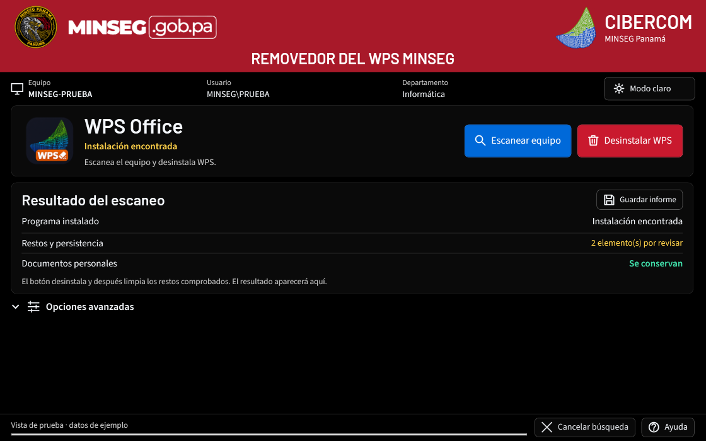

# REMOVEDOR DEL WPS MINSEG

Herramienta de Windows para desinstalar WPS Office, revisar su persistencia y limpiar restos comprobados conservando documentos. Versión del programa: **3.1.0**, edición centrada en WPS.

**Estado: candidato de pruebas sin firma.** La aceptación de SignPath Foundation y la firma pública siguen pendientes. No desactives Smart App Control, el antivirus ni las políticas del equipo para ejecutarlo. No se promete eliminación total ni compatibilidad certificada con un antivirus.



## Uso

1. Guarda y respalda tus documentos.
2. Abre el EXE autorizado para tu equipo y pulsa **Escanear equipo**.
3. Pulsa **Desinstalar WPS**. Windows puede solicitar administrador y el desinstalador del fabricante puede mostrar su asistente.
4. Lee los resultados y pendientes y guarda el informe de forma privada.
5. En **Opciones avanzadas**, comprueba Microsoft Office. En dominio, la configuración compatible se aplica al siguiente inicio de sesión.

Se conservan documentos, recuperación, nube y elementos cuya identidad no pueda comprobarse. No se cierran Explorer, Copilot ni la sesión del usuario. La herramienta usa límites de tiempo y alcance: un escaneo parcial no equivale a un equipo limpio.

Esta interfaz realiza acciones solo sobre WPS. El núcleo compartido contiene también componentes de AnyDesk/AppLocker heredados de 1.6.0, pero no se exponen ni aceptan como operaciones en esta edición.

## Descargas y documentación

- [Versiones de prueba](https://github.com/EAHV09/REMOVEDOR-WPS-MINSEG/releases): comprobar siempre la etiqueta de firma y los avisos de cada entrega.
- [Guía de uso](docs/GUIA.md) · [Cambios](docs/CAMBIOS-3.1.0.md) · [Pruebas locales de la versión](docs/PRUEBAS-3.1.0.md).
- [Office automático para TI](docs/OFFICE-AUTOMATICO-TI.md) · [Seguridad](SECURITY.md) · [Privacidad](PRIVACY.md).
- [Code signing policy](CODE_SIGNING.md) · [Firma con SignPath, paso a paso](docs/signpath/PASO-A-PASO.md).
- [Comprobaciones de la preparación pública](docs/signpath/VALIDACION-3.1.0.md).

Las capturas usan datos ficticios. Los informes de las PC y las credenciales no pertenecen a este repositorio.

## Compilar

Windows x64, .NET SDK **10.0.401** y runtime de destino **10.0.12**, fijados por el proyecto. El EXE es autónomo e incluye sus recursos; el código fuente se distribuye por separado.

```powershell
./scripts/Build-SignPathCandidate.ps1 -OutputDirectory ./dist/candidate-310
```

El script restaura dependencias bloqueadas, consulta vulnerabilidades, ejecuta las pruebas del núcleo y de la interfaz y publica un candidato. No ejecuta desinstalaciones ni prepara asociaciones del equipo. Falla si la consulta de vulnerabilidades no puede completarse o encuentra avisos altos/críticos.

El flujo **Compilar candidato 3.1.0** de GitHub Actions produce el EXE sin firma y evidencia. **Firma SignPath 3.1.0** solo puede solicitar firmas tras su configuración y aprobación. Los binarios para SignPath se compilan en GitHub; no se sube un EXE local como si tuviera origen verificado.

## Licencias y mantenimiento

Código: [Apache License 2.0](LICENSE). Fuentes y runtime: [componentes y licencias](docs/signpath/COMPONENTES.md). Los logos y marcas conservan sus derechos según [NOTICE](NOTICE); no constituyen una certificación institucional.

Mantenimiento: [@EAHV09](https://github.com/EAHV09). Este repositorio es independiente y contiene únicamente este proyecto.

## English summary

Windows WPS Office removal utility with a black/light interface, evidence-based residual cleanup, document preservation, and Microsoft Office association preparation for compatible domain policies. This 3.1.0 candidate is unsigned and has not completed a real endpoint pilot. SignPath Foundation acceptance is pending. Source and build workflows are public; endpoint reports and personal data are not collected by this repository.
